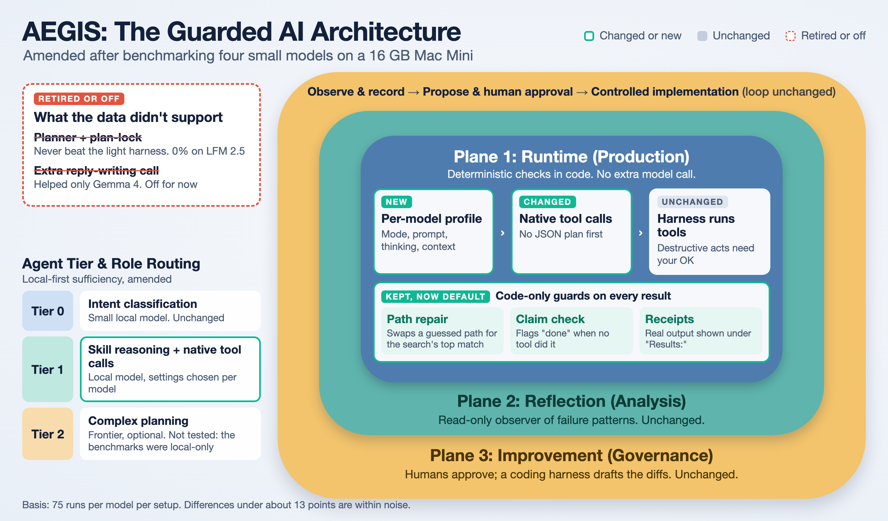
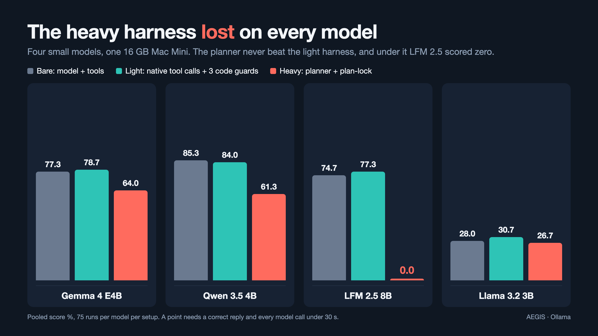

# AEGIS

[](https://github.com/mwkloh/aegis/actions/workflows/ci.yml)

> **Local-first, guarded cognitive system.** A personal AI assistant whose tool execution is correct *by architecture*, not by model capability — built to run usefully on small open-weights models (2B–13B; tested down to Gemma4:e2B) with frontier APIs as optional accelerators.

> ⚠️ **Status: experimental, single-operator R&D.** This repo is one person's running notebook for an idea — that the reliability of AI assistants comes from structure (gates, planes, contracts) more than from raw model intelligence. It is **not** a packaged product. APIs change without notice, the test suite assumes a specific operator workflow, and the canonical state lives outside the repo at `~/.aegis/`. Read it as a design exploration, not a drop-in tool.

---

## Why AEGIS exists

Most "agentic" wrappers around an LLM trust the model to report on its own tool use. When the model is GPT-5 / Claude Sonnet that mostly works. When it's a 4B local model running on a laptop, it doesn't — the model will happily reply *"I've deleted the duplicate files for you 🦊"* without ever emitting a tool call.

AEGIS treats every LLM reply as a **claim**, and uses a separate, deterministic layer to decide whether the claim is actually backed by an executed tool call. The layered defenses are the point of the project:

| Layer | What it stops |
|---|---|
| **Skills registry** | LLM cannot reach for tools it wasn't granted on this turn |
| **Multi-step loop with bounded steps** | LLM cannot loop forever, cannot escalate scope mid-chain |
| **Destructive guard** | Mutating tools (`files_delete`, `files_move`, `files_write`) at step 2+ are intercepted with a deterministic confirmation prompt — *no LLM rephrasing* |
| **Verdict gate** | Regex detects first-person action claims ("I deleted X", "I created Y") and prepends `⚠️ unverified tool claim — not executed` if the implied tool didn't actually run |
| **Tool-result audit trail** | Every executed tool emits a `tool.invoked` record; the verdict gate reads from this, not from the LLM's self-report |

The design principle, lifted from `AEGIS_BLUEPRINT.md`:

> LLMs decide **intent and planning**. Harnesses decide **execution**. Memory systems decide **persistence**. No component violates this.

---

## High-level architecture



*Teal-outlined boxes changed after the benchmarks described [below](#what-the-benchmarks-changed). Everything else is as originally designed.*

The path a request takes in **`native` mode**, which is what the starter config uses for `gemma4:e4b`:

```
┌──────────────────────────────────────────────┐
│              Chat Interface                  │
│             (Telegram / CLI)                 │
└────────────────────┬─────────────────────────┘
                     ▼
┌──────────────────────────────────────────────┐
│        Intent Classifier (Tier 0)            │
│        small local model, cheap              │
└────────────────────┬─────────────────────────┘
                     │ {intent, confidence}
                     ▼
┌──────────────────────────────────────────────┐
│           Skills Registry                    │
│   declarative YAML, read-only at runtime     │
└────────────────────┬─────────────────────────┘
                     │ selected skill descriptor
                     ▼
┌──────────────────────────────────────────────┐
│   Per-model profile  (config.json)           │
│   harness mode · native prompt · think ·     │
│   context window, chosen by measurement      │
└────────────────────┬─────────────────────────┘
                     ▼
┌──────────────────────────────────────────────┐
│   Tier-1 model calls tools natively          │
│   • no JSON plan written first               │
│   • bounded rounds (max 5 by default)        │
│   • allowed-tools list per skill             │
│   • destructive-guard interception           │
└────────────────────┬─────────────────────────┘
                     │ tool calls
                     ▼
┌──────────────────────────────────────────────┐
│              Harness Adapter                 │
│   the only path to side effects              │
│   (tool registry: files_*, time, echo, …)    │
└────────────────────┬─────────────────────────┘
                     │ tool results + audit trail
                     ▼
┌──────────────────────────────────────────────┐
│   Code-only guards (no extra model call)     │
│   path repair → claim gate → evidence        │
└────────────────────┬─────────────────────────┘
                     ▼
                   Reply
```

The older **`planner` mode** (the model first writes a JSON plan, then each step runs) is still in the code and selectable per model. It is what a model gets when `config.json` has no profile for it. The benchmark found it slower and no more accurate than `native` on the models tested, so it is no longer where the project's effort goes. Its extra mechanisms (completion gate, plan-lock, reply synthesis) are described under [Key features](#key-features) and are planner-mode only unless noted.

The codebase is split into **three planes**, enforced by import-graph tests:

- **Runtime (`runtime/`)** — classify, plan, execute tools, render replies. May not modify its own source or canonical memory files.
- **Reflection (`runtime/reflection/`)** — read-only sweep over today's events (`reflect` make target).
- **Improvement (`improvement/`, `coding_harness/`)** — drafts code patches as `.patch.md` files for human review (`harness` / `apply` make targets). Plane 1 may not import from this plane.

---

## Key features

### Bounded multi-step tool loop
The model can chain tools (e.g. `files_search` → `files_read` → respond), as planner steps or as rounds of native tool calls, but is hard-capped at `cfg.harness.max_steps` (default 5) either way. Termination conditions: planner returns `kind=respond`, step cap hit, registry empty, or destructive-guard interception. See `runtime/chat/telegram/harness_dispatcher.py:_run_multi_step`.

### Destructive guard + confirmation flow
Mutating tools are allowed at step 1 (the operator's explicit opening request) but intercepted at step 2+ with a deterministic message that surfaces the exact tool id and args — no LLM paraphrase between the model and the operator. Implemented as a `frozenset` lookup, not a prompt instruction, so it can't be jailbroken by clever phrasing. On interception the harness holds the pending intent and executes it only on an **exact-match** affirmative follow-up ("yes", "confirm", "go ahead") within a 120s TTL — no model in the confirmation loop, and the intent is armed only *after* the prompt is delivered, so a failed send can't leave an invisible pending action. See `runtime/chat/telegram/harness_dispatcher.py`.

### Evidence ledger
Every tool the harness executes leaves a structural proof record — skill, tool, an argv hash, a byte count, and a classified verdict (`verified` / `exit_nonzero` / `tool_error` / …) — appended to the session event shard, scoped to the turn. No argv contents or output bodies are stored. This is the substrate the completion gate reads. See `runtime/tools/record.py`.

### Completion gate
*(Planner mode.)* When the planner declares it's done (`kind=task_complete`), the harness checks the claimed summary against the turn's *verified* ledger evidence rather than trusting the model. A tool that failed (including a soft failure like a non-zero `run_command` exit) never counts as verified, and an unrecovered failure appends an honest "⚠️ this did not complete successfully" note to the reply. Annotate-not-block for now — the `harness.completion_gated` events measure how often a hard block would fire before one is turned on. This is the direct counter to a small model lying about completion.

### Schema-constrained decoding
For local models via Ollama, tool-call and plan JSON is constrained in the decoder itself (a JSON schema passed as Ollama's `format`, compiled to a GBNF grammar) so malformed output is impossible rather than merely discouraged — the single biggest reliability lever for 2B-class models. A deterministic `repair_json()` pass salvages wrapper noise (markdown fences, prose, trailing commas) before spending a corrective retry. Client-side schema validation stays the trust boundary; the decoder constraint is an optimization that can never weaken it.

### Guarded file writes and command runner
`files_write` writes text inside the configured sandbox roots (atomic tmp-then-rename, 256 KiB cap, symlink-escape rejected) and rides the confirmation flow above. `run_command` runs a read-only inspection command as an **argv list** — no shell, ever — against an operator-defined binary allowlist (`ls`, `cat`, `grep`, … by default; `find` deliberately excluded); path arguments are validated against the same sandbox roots as `files_read`, so it can't read the bot's own secrets. Both are opt-in and off by default.

### Reply verdict gate
Pure-function regex check against ~15 first-person claim patterns ("I've deleted", "I ran", "I created"), suppressed by negation/offer patterns ("I would", "I can"). Tool-pinned: "I deleted X" only fires the gate if `files_delete` is *not* in the verified-tools set for this turn. Fully unit-tested; conservative by design (prefers false negatives over annotation noise).

### Skills system
Each skill is a YAML descriptor with `trigger_intents`, `allowed_tools`, and an args schema. The reasoner sees only the tools its skill grants — broad capabilities don't leak into narrow tasks. Skills live in `~/.aegis/workspace/skills/`, seeded from `runtime/skills/_bundle/` on first boot.

### Local-model first
The default model stack assumes Ollama or LM Studio is running locally. OpenRouter / Anthropic / OpenAI are wired in but are accelerators, not requirements. See `runtime/llm/router.py` for tier routing.

### Memory tiering
Four-tier memory (preferences / identity / episodic / external knowledge) plus per-task execution memory. Memory is retrieved per-skill, summarized, never wholesale-injected. SQLite + sqlite-vec for embeddings. Optional Obsidian vault integration.

### Instrumented eval harness
`runtime/eval/` runs the real skill catalog against live models — no replayed transcripts, no mocks — and grades against the same evidence ledger the runtime uses. It reports **TGC** (per-run pass rate) and **SGC** (per-task, strict: every phrasing variant must pass), plus per-call telemetry so a failure says *why* it failed rather than only *that* it did: `timeout_exhausted`, `thinking_budget_exhausted`, `no_tool_call`, `wrong_tool`, `tool_errored`, `incomplete_chain`, `repeated_step`.

Two design points that changed what the numbers mean. **Capability and the shipped budget are reported separately** — `tgc_within_budget` says whether a passing run would also have fit the 30 s production timeout, because a model can be capable and unusable at once. And **the eval gets its own generous read timeout**, so a slow model is measured on what it can do rather than cut off mid-answer; the production path keeps its shipped timeout untouched. Slow and incapable are different findings, and conflating them previously published a working model as a flat 0%.

Never runs in CI, costs real tokens: `python -m runtime.eval.cli --yes` (`--repeat N` for variance, `--read-timeout`, `--no-prewarm`).

---

## What the benchmarks changed

The first design wrapped small models in a lot of structure: a planner that wrote its steps as JSON, a plan-lock that narrowed each step to one tool, a completion gate, an evidence ledger. Then each piece was switched off in turn and measured. Four small models (Gemma 4 E4B, Qwen 3.5 4B, LFM 2.5 8B, Llama 3.2 3B) ran through Ollama on one 16 GB Mac Mini, 75 runs per model per setup. A run scored only if the reply was correct **and** every model call finished inside 30 seconds.



| Model | Bare | Light (`native` + 3 guards) | Planner + plan-lock |
|---|---:|---:|---:|
| Gemma 4 E4B | 77.3% | 78.7% | 64.0% |
| Qwen 3.5 4B | 85.3% | 84.0% | 61.3% |
| LFM 2.5 8B | 74.7% | 77.3% | **0.0%** |
| Llama 3.2 3B | 28.0% | 30.7% | 26.7% |

**What the data said**

- The heavy planner never beat the light harness on any model. Under it LFM 2.5 never made a single tool call and scored zero; why is not known, and the light harness avoids it.
- Light costs about one extra model call per task. The planner roughly triples the wait on the hard suite.
- Three things are kept on, and none needs a model call, so they cost almost nothing to leave in: **path repair** (a path the model guessed right after a search is swapped for the search's own top match), the **claim check** (a reply that says something was done with no successful tool call behind it gets a note), and **receipts** (the real tool output is shown under a `Results:` header). Their measured benefit is small. A later re-check on the honesty suite, no guards against the light guards at 75 runs per setup, found no difference for LFM 2.5 8B or Qwen 3.5 4B. It was run twice. At the default context window the scores were LFM 78.7% both ways and Qwen 92.0% both ways. At the starter per-model settings (32k context, `think` on for Qwen) they were LFM 74.7% both ways and Qwen 89.3% without the guards against 88.0% with them. The same setup moved by 3 to 4 points between the two runs, as large as any guard effect. The earlier 30-run gaps of about 7 points for those models did not repeat. Llama 3.2 3B and Gemma 4 E4B were not re-checked, and failures cluster by task phrasing (one Qwen phrasing failed every run under both setups), so the effective sample is closer to 15 phrasings than 75 runs. Both models' remaining failures were wrong or errored tool calls, which happen before any guard runs. Treat the guards as cheap safety nets, not as a proven gain.
- Plan-lock, measured against the same planner without it: Llama 3.2 3B +8.0 points, Qwen 3.5 4B −22.7, Gemma 4 E4B −2.7, LFM 2.5 8B 0.0. It is off.
- An extra model call to write the final reply (`synthesis`) lifted Gemma 4's hard-suite score from 56.7% to 63.3%; elsewhere the change was inside the noise. It is off.
- Parameter count did not predict results. The 8B LFM scored below both 4B models. A 9B Qwen scored 92.0% bare, the best of anything tried, but decoded at about 18 tokens per second against 67 for Gemma 4 E4B, which is too slow for an assistant on 16 GB.
- The persona prompt that production uses held up in `native` mode for Qwen 3.5 4B, Gemma 4 E4B and LFM 2.5. For Llama 3.2 3B it raised the share of flagged replies by about 9 points, so that model keeps the bare prompt.

**What that changed in AEGIS**

- `harness_mode` (`native` or `planner`), `native_prompt` (`identity` or `bare`) and `guardrails` are now **per-model settings** in `config.json`. See [Per-model profiles](#per-model-profiles).
- `native` mode runs three code-only guards by default: `autofill` (path repair), `claim_gate`, `evidence` (receipts). `plan_lock` and `synthesis` are opt-in.
- Settings are chosen per model, not per parameter count.

**Reproducing it.** The five setups compared are eval arms: `bare` (the model and the tool catalogue only), `native-guard` (light), `native-guard-synth` (light plus the reply-writing call), `full-nolock` (planner without plan-lock) and `full` (planner with plan-lock). The easy suite is `eval/tasks` (15 phrasings, run three times for 45 runs per model per setup), the hard suite `eval/tasks_hard` and the honesty suite `eval/tasks_honesty` (15 phrasings each, run twice for 30). Easy plus hard is the 75-run pool in the table. Commands are under [Using your own local model](#using-your-own-local-model). The overnight driver scripts that ran the whole matrix are not part of this repo, so you run one arm and suite at a time.

**How far to trust this.** It is one machine, four models and 75 runs per setup, so gaps under about 13 points cannot be told apart, and that covers most differences between bare and light. "Light came top on three of four models" is best read as a tie broken on cost. The 30-run honesty figures are noisier still: the same setup, rerun at 75 runs, moved by up to 9 points on two models. The persona-prompt result is a single run, and why Llama reacted badly was not isolated. The figures above are not a general benchmark of these models. The full record is in `docs/superpowers/plans/2026-10-04-mac-mini-rerun-and-bare-arm.md` (sections 18–23) and the design in `docs/superpowers/specs/2026-10-06-harness-ablation-design.md`. You can reproduce a run with the commands under [Using your own local model](#using-your-own-local-model).

---

## Installation

### Prerequisites

- **Python 3.11+** (project tested on 3.11–3.13) and **git**
- **[Ollama](https://ollama.com)** running locally. It serves every model AEGIS uses by default, so **no API key is needed to get started**
- Optional: a Telegram bot token if you want the chat interface (`@BotFather`)
- Optional: an OpenRouter / Anthropic / OpenAI key for frontier-tier routing

### Quickstart

```bash
# 1. Prerequisites (macOS shown; on Linux use your package manager)
brew install ollama python@3.12
ollama serve &                 # or just open the Ollama app

# 2. Get the code and the two models the defaults use
git clone https://github.com/mwkloh/aegis.git
cd aegis
ollama pull gemma4:e2b         # Tier 0: intent classification
ollama pull gemma4:e4b         # Tier 1 + reflection

# 3. Install, provision ~/.aegis/, and verify everything
make setup

# 4. Try the terminal demo (a small walking skeleton: `ping`, `echo hi`,
#    `what time is it in Tokyo?`). The full assistant is the Telegram bot, below.
make run
```

If `make setup` ends with a `✗`, the doctor prints the fix next to it (usually an `ollama pull`). `make doctor` is re-runnable and safe at any time.

`make setup` runs three steps you can also invoke individually:

| Step | What it does |
|---|---|
| `make install` | Creates `.venv` and installs runtime + dev dependencies via pip |
| `make bootstrap` | Idempotently provisions `~/.aegis/` from `templates/workspace/` (identity, memory, sessions, skills), and writes a starter `.env` and `config.json` if absent. Never overwrites anything you've edited |
| `make doctor` | Checks Ollama is reachable, the configured models are pulled, the `~/.aegis/` layout is complete, and any optional API keys work |

To keep state somewhere other than `~/.aegis`, set `AEGIS_ROOT` before running any of the above; bootstrap, doctor and the bot all honour it.

### Configure secrets and models

Settings live in two files under `~/.aegis/`, both created by bootstrap:

- **`.env`**: which models to use (`MODEL_*`), provider keys, Telegram credentials.
- **`config.json`**: harness behaviour, per-model profiles, Telegram on/off, file sandbox.

Models are chosen in `.env`, not `config.json`. The defaults run everything on Ollama:

```bash
MODEL_FAST=gemma4:e2b            # intent classification
MODEL_SMART_LOCAL=gemma4:e4b     # skill reasoning
MODEL_SMART_PROVIDER=ollama      # ollama | openrouter
```

To use a hosted model for the reasoning tier instead, set `MODEL_SMART_PROVIDER=openrouter`, `MODEL_SMART=<vendor>/<model>` and `OPENROUTER_API_KEY`. For the Telegram bot add:

```bash
TELEGRAM_BOT_TOKEN=...
TELEGRAM_ALLOW_FROM=<your-numeric-tg-user-id>
```

and set `"telegram": {"enabled": true}` in `config.json`.

The starter `config.json` already turns on the multi-step tool loop:

```json
{
  "harness": {
    "multi_step": true,
    "max_steps": 5
  }
}
```

The flag can also be set per-process via `HARNESS_MULTI_STEP=1`.

#### Choosing a harness mode

The benchmark behind this project (`docs/superpowers/plans/2026-10-04-mac-mini-rerun-and-bare-arm.md`) ran 3–9B models on a 16 GB Mac Mini. In short: the lightest harness mode, `native` (the model calls tools itself, with three plain-code guards), matched or beat the heavy planner on all four models in the final comparison and was roughly 2–3x faster on the hard suite. The starter config enables it, with the other per-model settings the benchmark chose, for `gemma4:e4b`, `gemma4:e4b-mlx`, `qwen3.5:4b-mlx`, `lfm2.5:8b` and `llama3.2:3b` (all at a 32k context window; Llama 3.2 3B also keeps the bare prompt, and Qwen 3.5 4B needs its reasoning channel on). Gemma was measured on the `-mlx` build. The plain `gemma4:e4b` tag, which the defaults pull, is the same weights; a spot check of it on the honesty suite (30 runs) scored 90% against 100% for `-mlx`. Three runs is inside the noise at that size, but it is a reason to run the eval on your own setup before trusting these numbers. Any other model has no profile, so it uses the planner. See [Per-model profiles](#per-model-profiles) to change that.

#### Using your own local model

`gemma4:e4b` is only the default. To run a different model:

1. **Pull it:** `ollama pull <your-model>` (any tag shown by `ollama list` works).
2. **Point the smart tier at it** in `~/.aegis/.env`, replacing the placeholder:

   ```bash
   MODEL_SMART_LOCAL=<your-model>
   ```

   (`MODEL_FAST` and `MODEL_REFLECTION` work the same way for the other two tiers.)
3. **Check it:** `make doctor` confirms the model is pulled and prints the `ollama pull` fix if it isn't.
4. **Choose a harness mode for it** in `~/.aegis/config.json`. Keys are the exact model id:

   ```json
   {
     "modelProfiles": {
       "<your-model>": { "harness_mode": "native", "num_ctx": 32768 }
     }
   }
   ```

   With no profile the model uses the planner. `native` was faster and at least as accurate on every model benchmarked here, but that is a measurement about those models, not a promise about yours. `num_ctx` is the 32k window the benchmark ran at; without it Ollama picks the window itself, and some models default to one far too large for a 16 GB machine (`qwen3-vl:4b` was sized at 43 GB and every call timed out).
5. **Measure it** (optional, slow, uses your local model; see [Instrumented eval harness](#instrumented-eval-harness)). The default arm is `full`, the heavy planner, so name the arm you mean:

   ```bash
   # the "light" setup, on the easy, hard and honesty suites
   .venv/bin/python -m runtime.eval.cli --yes --arm native-guard --repeat 3
   .venv/bin/python -m runtime.eval.cli --yes --arm native-guard --tasks-dir eval/tasks_hard --repeat 2
   .venv/bin/python -m runtime.eval.cli --yes --arm native-guard --tasks-dir eval/tasks_honesty --repeat 2
   # the planner with plan-lock, for comparison: same commands with --arm full
   ```

   Compare `tgc` and `tgc_within_budget` between the two. With a few dozen runs per arm, differences under roughly 15 points are noise.

#### Example paths in the bundled skills

The skill descriptors in `runtime/skills/_bundle/` (`read_file`, `list_files`, `search_files`, `file_info`, `write_file`, `run_command`) show the model example paths such as `/Users/YOUR_USERNAME/Desktop/foo.png`. **Replace `YOUR_USERNAME` with your own account name** so the examples point at a folder that exists on your machine (on Linux use `/home/<you>` instead of `/Users/<you>`).

Skills are copied into `~/.aegis/workspace/skills/` on first run and never overwritten afterwards, so there are two ways to do it:

- **Your installed copies** (affects your assistant only). After `make setup`:

  ```bash
  # macOS; on Linux use `sed -i` with no `''`
  sed -i '' "s#YOUR_USERNAME#$(id -un)#g" ~/.aegis/workspace/skills/*/skill.yaml
  ```

- **Before first run** (affects what gets seeded): run the same `sed` on `runtime/skills/_bundle/*/skill.yaml` first, then `make bootstrap`.

`make doctor` prints a warning (with this command filled in for your paths) until no installed skill still contains `YOUR_USERNAME`.

The examples are only hints to the model; the file tools are limited to the sandbox roots in `config.json` regardless. The eval harness works in a throwaway temp directory, so benchmark runs never need these paths to exist. The example text is still part of the prompt, though: the published benchmark numbers were measured with a real username in it, so if you compare against them, note that yours differs.

#### Per-model profiles

Some model settings are not safe to set tier-wide. Ollama's reasoning channel is the measured example: turning it off took `qwen3-vl:4b` from 40% to 80% TGC, and dropped `qwen3.5:4b-mlx`'s within-budget score from 73.3% to 6.7% — the same switch, opposite signs. Set those per model instead:

```json
{
  "modelProfiles": {
    "qwen3-vl:4b":    { "think": false },
    "qwen3.5:4b-mlx": { "think": true }
  }
}
```

The same per-model block carries the harness settings the benchmark chose (see [What the benchmarks changed](#what-the-benchmarks-changed)):

```json
{
  "modelProfiles": {
    "gemma4:e4b":   { "harness_mode": "native" },
    "llama3.2:3b":  { "harness_mode": "native", "native_prompt": "bare" }
  }
}
```

- `harness_mode`: `native` (the model calls tools itself) or `planner` (JSON plan first). No profile means `planner`.
- `native_prompt`: `identity` (speaks as your `IDENTITY.md`, the default) or `bare` (the eval's two-sentence prompt). `bare` is what Llama 3.2 3B needed.
- `guardrails`: a list from `autofill`, `claim_gate`, `evidence`, `synthesis`, `plan_lock`. Left unset, `native` runs the first three. `plan_lock` is rejected in `native` mode because it needs the planner's step list.

`MODEL_HARNESS_MODE` and `MODEL_GUARDRAILS` in `.env` override every profile; they exist for eval runs and debugging sessions, so leave them unset normally.

Keys match on **exact model id** — there is no family-prefix fallback, because the two models above share a vendor string and need opposite values. A model with no profile keeps its own default. `MODEL_SMART_THINK` in `.env` is a global override that beats every profile, so it stays the escape hatch for a debugging session; leave it unset for profiles to apply. Ollama-only — OpenRouter has no equivalent request field.

### Run

```bash
# CLI walking skeleton — no Telegram needed
make run

# Production Telegram bot (requires TELEGRAM_BOT_TOKEN + Ollama up)
.venv/bin/python -m runtime.serve

# Recommended: run inside tmux to survive macOS TCC prompts
tmux new -d -s aegis '.venv/bin/python -m runtime.serve 2>&1 | tee -a ~/.aegis/logs/aegis-tmux.log'
```

### Test

```bash
make test           # full gate: ruff + mypy + unit + e2e
make test-unit      # fast loop
make security       # bandit + semgrep
```

---

## Maintaining and releasing

The repeatable change → verify → PR → release loop is documented in
[`docs/MAINTAINING.md`](docs/MAINTAINING.md); notable changes per version are in
[`CHANGELOG.md`](CHANGELOG.md). The short version: branch, change it test-first,
`make test` must be green, PR it, and tag a release from a clean `main`.

---

## Repository layout

```
runtime/             Plane 1 — chat, intent, skills, reasoning, harness, llm
  chat/              CLI + Telegram surfaces; reply_verdict.py lives here
  intent/            Tier 0 classifier (small local model)
  skills/            Skill registry + bundled descriptors
  reasoning/         Tier 1 skill-scoped planner; prompts/ holds the chain templates
  harness/           Tool registry + execution adapter (the only path to side effects)
  llm/               Ollama / OpenRouter / OpenAI / Anthropic clients + tier router
  eval/              Live-model benchmark harness (TGC/SGC, failure taxonomy, telemetry)
  reflection/        Read-only event sweep (Plane 2)
  improvement/       Patch-draft pipeline (Plane 3, draft-only)
  scheduler/         Cron-style job runner (UTC internally)
  events/            Append-only JSONL audit trail (~/.aegis/workspace/sessions/)
coding_harness/      Plane 3 patch-application harness
memory/              SQLite + sqlite-vec memory store
scripts/             aegis-doctor, aegis-bootstrap, aegis-telegram-smoke, …
eval/                Benchmark task definitions (tasks/) and results (results/, gitignored)
docs/                ADRs and design plans
deploy/              launchd plists for macOS supervised runs
tests/               1600+ unit/integration/e2e tests
AEGIS_BLUEPRINT.md   Original design document
```

Canonical *operator* state lives outside the repo:

- `~/.aegis/workspace/` — agent workspace (memory, sessions, identity, skills)
- `~/.aegis/.env` — secrets
- `~/.aegis/config.json` — runtime config
- `~/.aegis/logs/` — log files

---

## Caveats and limitations

- **Experimental and unstable.** Schemas, tool ids, gate patterns, and configuration shape change as the design is iterated. There is no semver contract.
- **Single-operator assumptions.** Authentication is a numeric Telegram user-id allowlist. There is no multi-tenant isolation, no RBAC, no audit-export tooling for compliance contexts. Do not point this at strangers.
- **macOS-shaped.** The deploy story (`launchd`, tmux, TCC), the file-tool sandbox, and the doctor checks assume macOS. Linux probably works for the runtime but is untested.
- **The gates are conservative, not infallible.** The verdict-gate regex set is curated to lean toward false negatives (missed flags) over false positives (annotation noise). The destructive guard only catches the listed tool ids — adding a new mutating tool requires adding it to `DESTRUCTIVE_TOOLS` *and* writing a unit test. The completion gate annotates rather than blocks (see open questions in `docs/PLAN_PHASE_11_CAPABILITY_FLOOR.md`). Read `runtime/chat/reply_verdict.py` and `runtime/chat/telegram/harness_dispatcher.py` before trusting any layer in a new context.
- **The confirmation flow and multi-step tools require `harness.multi_step`.** The destructive guard, the confirmation flow, and chained tool use only run when the multi-step loop is enabled (`harness.multi_step=true` or `HARNESS_MULTI_STEP=1`). In the default single-shot mode a directly-requested `files_write` executes as the operator's stated step-1 intent without confirmation.
- **`run_command` containment is an allowlist plus path-sandboxing, not a jail.** It refuses non-allowlisted binaries and validates absolute/`~` path arguments against the sandbox roots, but it is not a full sandbox: a bare relative token with no separator resolves against the process working directory. Extend `commands.allowed_binaries` deliberately — adding `find`, `rm`, or an interpreter re-opens execution vectors the defaults exclude.
- **Local-model dependency.** With Ollama down, the harness dispatcher logs `harness_dispatcher.disabled` and the bot falls back to plain chat. Multi-step tool use requires a working local classifier.
- **Solo project, solo issue tracker.** Issues live as markdown files under `.scratch/<feature>/` in this repo, not on GitHub Issues. Triage labels and conventions are documented in `docs/agents/`.
- **Benchmark numbers are conditional, and some models have no stable score at all.** Results depend on `config.json` state, since the eval harness builds its dispatcher through the same path as production and therefore inherits `modelProfiles` — record the active profiles next to any number you quote. Two of the models measured here (`gemma4:e2b-mlx`, `llama3.2:3b`) have no per-task pass/fail state, only a pass *rate*: at n=45 they sit at 64.4% and 24.4%, with individual tasks splitting 5/9, 3/6, 1/9. Any single-run claim about them is one sample from a coin flip — use `--repeat 3` at minimum. Read `tgc` and `tgc_within_budget` together; a model can be capable and too slow to ship, and reporting only one of those mis-tells it in either direction.

## License

[MIT](LICENSE) — see the `LICENSE` file. Do whatever you want with it; just keep the copyright and disclaimer.

## Acknowledgements

The design is heavily influenced by Anthropic's structured-tool-use patterns and by the broader "small model + good scaffolding > big model + thin wrapper" line of thinking. The blueprint document (`AEGIS_BLUEPRINT.md`) preserves the original v1 reasoning.
